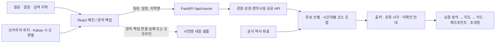

# 오픈나들이 OpenNadeuli

**[오픈나들이 사용하기 ↗](https://opennadeuli.vercel.app/)** · [제품 기획서](docs/기획서.md)

휠체어·보행 약자와 동행 가족이 방문 전에 접근성 정보를 확인하고, 시간대에 맞는 나들이 코스를 계획하는 무장애 관광 AI 에이전트입니다.


<sub>운영 사이트의 모바일 Chrome 뷰포트 390px에서 캡처한 첫 화면</sub>

## 사용 방법

1. 빠른 질문을 누르거나 “휠체어로 편한 부산 실내 나들이 코스 추천해줘”처럼 입력합니다.
2. **일정·시간대 및 지역 설정**에서 당일·1박 2일, 일자별 시작·종료 시간, 식사·카페·숙소 포함 여부와 검색 지역을 고릅니다.
3. 결과의 **요청 분석과 조회 기록 → 전체 동선 지도 → 장소 카드 → 체크포인트와 방문 전 확인 메모**를 읽습니다. 장소 카드에서 카카오맵 검색과 길찾기를 열 수 있습니다.
4. **가족 단톡방용 초대장 만들기**에서 일정을 편집하고 전체 복사합니다.

질문에 명시한 지역이 우선입니다. 지역이 없으면 직접 선택한 지역, 자동 모드에서 확인한 현재 위치의 시·도를 사용합니다. 위치 권한 허용을 감지하면 좌표를 다시 요청합니다. 시간 초과 시 탭 세션에서 최근 30분 내 확인한 지역을 사용할 수 있으며, 적용 가능한 지역을 얻지 못하면 기본 지역 서울과 사유를 표시합니다. 늦게 위치를 확인하면 재검색할 수 있습니다.

검색 중에는 진행 상태를 표시하고, 완료되면 응답 상단에서 시작해 조회 기록·지도·카드가 순서대로 나타납니다. 모션 감소 환경에서는 애니메이션을 생략합니다. 첫 화면의 빠른 추천은 입력창 위 한 곳에서 제공하며, 모바일에서는 검색 시 추천 줄을 접어 결과 공간을 확보합니다. **추천 검색**으로 다시 열 수 있습니다.

## 아키텍처

아래 흐름도는 **1단계(11월 22일 시연 기준)** 구현입니다. FastAPI가 규칙으로 요청 의도를 파악하고, 코드에 정의된 조건에 따라 공공 API를 조회해 코스를 조합합니다.



메인 화면은 React·TypeScript·CSS, 백업은 HTML·CSS·Vanilla JS, 코스 API는 Python·FastAPI입니다. 두 화면이 같은 오리진의 `/api/course`를 사용합니다. [정적 백업 직접 열기](https://opennadeuli.vercel.app/elice-final.html)

## 데이터 출처와 판정 범위

| 출처 | 서비스에서 사용하는 범위 |
| --- | --- |
| [한국관광공사 무장애 여행 정보](https://www.data.go.kr/data/15101897/openapi.do) | 열린관광지·문화시설과 숙박(`contentTypeId=32`) 후보 및 원문에 기재된 휠체어 접근, 출입구, 화장실, 주차 등 |
| [소상공인시장진흥공단 상가(상권)정보](https://www.data.go.kr/data/15012005/openapi.do) | 관광지 또는 지역 기준점 반경 600m의 식당·카페 후보. 업종·상호를 필터링하며 출입구 턱이나 좌석·편의시설은 해당 응답으로 판단하지 않음 |
| 지자체 무장애 탐방로 및 [국립공원공단 탐방로 등급제 정보](https://www.data.go.kr/data/15032340/fileData.do) | 검토 자료. 부산을 포함해 추천 구간별 **최대 경사도**가 확인된 공식 원본이 없어 실시간 경사도 필터 및 탐방로 배치 보류 |
| [한국사회보장정보원 장애인편의시설 현황](https://www.data.go.kr/data/15092317/openapi.do) | KDPCF 시설 목록·기구표 현황 조회. 이름과 주소가 일치한 숙소의 보조 정보, 방문 지점 직선 400m 이내 편의시설 참고. 별도 통계 집계나 설비 가동 여부 판정은 제공 범위 밖 |
| [부산교통공사 장애인 편의시설 정보](https://www.data.go.kr/data/15158993/openapi.do) 및 [국가철도공단 역사 좌표](https://data.kric.go.kr/rips/M_01_01/detail.do?id=32) | 부산 장소에서 직선 600m 이내 인근 역의 설치 설비와 개수. 승강기 고장·점검 현황과 보행 경로는 확인 대상 밖 |
| [카카오 지도 JavaScript SDK](https://apis.map.kakao.com/web/documentation/) · [OpenStreetMap Nominatim](https://nominatim.org/) | 카카오는 지도·지역 판별·검색·길찾기에 사용. Nominatim은 동선 핀 좌표가 없을 때 장소 검색을 보조 |

**KDPCF의 현재 연동 제공기관은 한국사회보장정보원**입니다. 한국장애인개발원 데이터가 별도로 연동된 상태는 아닙니다.

- **공공 API 조회**는 조회 출처를 뜻합니다. **공공데이터에 기재** 표시와 안심 체크포인트는 원본에 근거한 항목에만 사용합니다. API 조회 시각과 원본 기준·갱신일은 구분하고, 제공되지 않은 원본 날짜는 미제공으로 표시합니다.
- 원본에 없는 접근성, 설비 작동 여부, 매장 영업 여부는 방문 전에 확인하도록 안내합니다. 유효한 원본 전화번호가 있는 경우에만 전화 연결을 제공합니다.
- 카카오맵의 상호·지점명·영업 정보는 상권 원본과 다를 수 있습니다. 상호 검색, 전체 주소 검색, 좌표 길찾기를 각각 제공합니다.
- 공식 조회가 성공했지만 결과가 없으면 빈 결과로 안내합니다. 백업은 서버 연결 실패 시 **시연용 내장 샘플**로 전환합니다.

## 향후 로드맵 · 2단계 개발 과제

**2단계(11월 22일 이후)**에는 1단계 워크플로우에 RAG·LLM을 보조적으로 결합하고, 실시간·세부 접근성 데이터를 확장합니다.

1. **백엔드 워크플로우 + RAG·LLM** — LLM으로 요청 의도 파싱을 보완하고, 출처가 확인된 공공데이터와 공식 문서를 검색하는 RAG를 활용해 코스 설명·주의사항·초대장 문구를 작성합니다. 후보 선정, 근거 부족 시 보류, 공식 조회의 빈 결과 유지, 출처·조회 시각 표기, 현장·유선 확인 안내는 백엔드 규칙으로 처리합니다.
2. **공식 경사도와 탐방로** — 추천 구간별 공식 최대 경사도 원본을 확보한 뒤 8% 이하 필터링과 코스 배치를 활성화합니다. 근거가 부족한 구간은 보류합니다.
3. **승강기 가동 상태와 휠체어 이동 경로** — 도시철도 역사 승강기 실시간 가동 상태를 연동하고, 접근성 근거가 확보된 구간의 휠체어 보행 경로를 안내합니다. 설치 현황과 가동 상태는 별도로 표시합니다.
4. **식당·카페 접근성과 위치 권한 UX** — 출입구 턱·휠체어 이용 좌석·화장실 정보를 보강하고 출처와 확인 여부를 표시합니다. 기기·브라우저별 위치 권한 처리, 측위 지연·시간 초과 안내, 검색 지역 선택 흐름을 개선합니다.

## 로컬 실행과 배포

저장소 루트에서 `.env.example`을 참고해 서버 환경변수를 설정합니다. 공공 API 인증키는 로컬 `.env` 또는 Vercel 서버 환경변수에만 저장합니다.

```bash
python3 -m pip install -r requirements.txt
npm --prefix frontend ci
python3 -m uvicorn app:app --host 127.0.0.1 --port 8899
```

별도 터미널에서 개발 서버를 시작합니다. Vite가 `/api`를 FastAPI로 프록시합니다.

```bash
npm --prefix frontend run dev
npm --prefix frontend run build
npm --prefix frontend run build:offline
python3 test_backend.py
```

- 개발 메인 `http://localhost:5176/`, 개발 백업 `http://localhost:5176/elice-final.html`
- 일반 빌드 `frontend/dist`, 오프라인 빌드 `frontend/dist-offline/elice-offline.html`. 오프라인 HTML 하나를 저장해 열면 내장 샘플을 볼 수 있습니다.
- 별도 API 오리진을 사용할 때만 `VITE_API_BASE`와 서버 `CORS_ORIGINS`를 지정합니다. 카카오 JavaScript SDK 키의 허용 도메인에 개발·배포 주소를 등록합니다.
- GitHub 작업 브랜치 → PR → Vercel Preview 확인 → 사용자 머지 순으로 진행합니다. 연결된 `main`의 변경은 Vercel 운영에 자동 배포됩니다.

[배포 설정](vercel.json) · [서버 환경변수 예시](.env.example) · [기능별 명세](docs/specs/)
