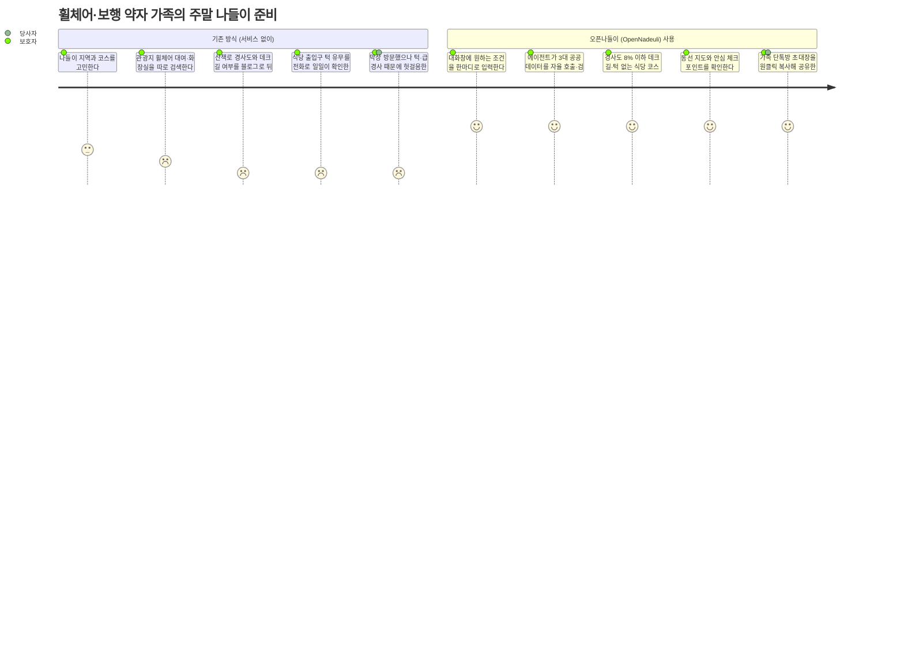
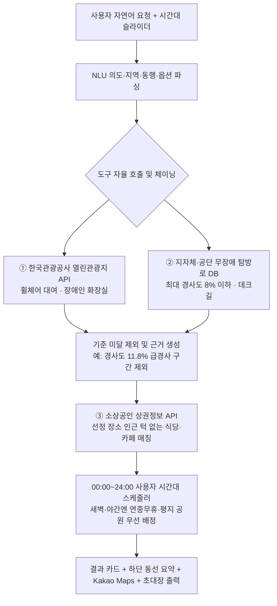

# 기획서 — 오픈나들이 (OpenNadeuli)

> 이 문서는 **왜 만들었고 무엇을 해결했는가**를 다룬다.
> 코드 구조·실행 방법·API 설정 절차는 [README.md](../README.md)에 있다.
>
> 최종 갱신: 2026-11-17

| 항목 | 내용 |
|---|---|
| 프로젝트 | 오픈나들이 (OpenNadeuli): 휠체어·보행 약자를 위한 무장애 관광 AI 에이전트 |
| 주제 유형 | 공공데이터(Open API) 자율 연동 및 배리어프리 동선 오케스트레이션 AI 에이전트 |
| 대상 타깃 | 휠체어·보행 보조기 이용 당사자 및 70대 노부모를 모시는 30~40대 보호자 |
| 기술 스택 | HTML5 · CSS3 · Vanilla JS (ES Modules) · 공공데이터포털 Open API · Kakao Maps SDK |
| 배포 형태 | 무의존성 정적 웹앱 (`index.html` / `standalone.html` · 로컬 및 웹 서버 즉시 실행) |

## 한 줄 소개

일상적인 대화 한마디만으로 한국관광공사 열린관광지·무장애 탐방로·턱 없는 식당 공공데이터를 자율 연동하여, 휠체어·보행 약자 가족이 사전 조사나 현장 헛걸음 걱정 없이 바로 떠날 수 있는 맞춤형 배리어프리 나들이 코스와 동선 지도를 원스톱으로 제안하는 AI 에이전트.

---

## 1. 문제 정의

> **휠체어·보행 약자 가족은 기존 지도와 여행 앱이 ‘출입구 턱 유무’, ‘산책로 경사도’, ‘장애인 화장실 위치’ 같은 핵심 배리어프리 정보를 알려주지 않아 사전 검색에 큰 피로감을 느끼고 현장 헛걸음을 반복하고 있으므로, 대화 한마디로 검증된 무장애 장소와 24시간 유연한 동선을 한 번에 조율해 주는 AI 에이전트가 필요하다.**

### 대상 사용자 (Persona)

1. **주 사용자(보호자):** 주말마다 보행 보조기나 휠체어를 이용하는 70대 노부모님을 모시고 근교 나들이를 계획하는 30~40대 자녀(보호자).
2. **수혜 당사자:** 계단·급경사·문턱 때문에 외출 자체를 망설이는 휠체어 이용자 및 거동이 불편한 고령층.

### 지금 겪는 불편 (Pain Points)

일반 지도 앱과 블로그 검색은 **파편화된 정보**만 제공하여, 이동 약자 관점의 실제 접근성을 보장하지 못한다.

> "맛집이라고 찾아갔는데 입구에 계단 3개가 있어서 차를 돌렸어요."
> "산책로가 평지인 줄 알았는데 경사가 너무 가팔라 수동 휠체어로 올라갈 수 없었어요."

### 고객 여정 맵 (Customer Journey Map)

점수가 낮을수록 사용자가 외출을 포기하거나 막히는 지점이다.

| 단계 | Pain Point | 오픈나들이 개입 |
|---|---|---|
| 조건 탐색 | 복잡한 필터·여러 앱을 오가는 피로감 | 자연어 대화 입력 + 상황별 원클릭 추천 질문 칩 |
| 장소 검증 | 무장애 정보의 파편화 및 허위 정보 | 3대 공공데이터 자율 호출 + 경사도 8% 이하 필터링 |
| 일정 배분 | 가족 생활 패턴에 맞지 않는 경직된 시간표 | 00:00~24:00 사용자 지정 슬라이더 기반 유연한 스케줄링 |
| 동선 확인 | 텍스트만으로는 실제 이동 거리·순서 파악 불가 | 본문 하단 전체 동선 요약 + Kakao Maps 시각화 |
| 가족 공유 | 일정을 정리해 가족에게 전달하기 번거로움 | 안심 체크포인트가 포함된 '가족 단톡방 초대장' 원클릭 복사 |

### 기존 지도·여행 서비스만으로는 부족한 이유

| 서비스 | 분류 | 한계 |
|---|---|---|
| 네이버·카카오맵 | 범용 지도 | 식당 입구 단차(문턱), 산책로 경사도(%), 휠체어 대여 여부 미제공 |
| 일반 여행 블로그·후기 | 비정형 정보 | 작성자 기준의 주관적 평가("갈 만하다")로 휠체어 진입 보장 불가 |
| 단순 공공데이터 포털 | 원시 데이터 | 관광지·탐방로·상권 데이터가 기관별로 흩어져 있어 동선 조합 불가 |

---

## 2. 해결 방식 (Architecture & Agent Pipeline)

사용자의 자연어 발화와 시간대 설정을 입력받아 **의도 분석 → 공공 API 자율 호출 → 무장애 기준 검증·필터링 → 24시간 동선 조립 → 지도·초대장 시각화**까지 자동으로 잇는다.

### 에이전트 툴 체이닝(Tool Chaining) 계약

| 단계 | 도구 (Function) | 입력 | 출력 및 검증 기준 |
|---|---|---|---|
| 1 | `searchOpenTouristSpots` | 지역 코드, 테마, 운영시간 | 열린관광지 목록 (휠체어 대여, 전용 주차, 장애인 화장실) |
| 2 | `searchAccessibleTrails` | 지역, 난이도 기준 | 무장애 산책로 (최대 경사도 **8% 이하**, 안전 난간, 휴식 공간) |
| 3 | `searchStepFreeRestaurants` | **1·2단계 선정 장소 좌표**, 끼니/카페 옵션 | 인근 반경 내 출입구 무턱(Step-Free) 식당 및 저상 테이블 카페 |

> **동선 정합성 보장:** 3단계 식당 조회는 임의의 지역 전체가 아니라 **1·2단계에서 최종 확정된 관광지·산책로의 실제 좌표를 인자로 받아** 호출하므로, 관광지와 식당이 동떨어지는 동선 모순을 차단한다.

---

## 3. 범위 (Scope)

### 할 것 (In Scope)

- **대화형 배리어프리 큐레이션:** 자연어 질문 및 원클릭 추천 질문 4종 제공
- **상세 일정 제어 아코디언:** 당일 / 1박 2일 선택, `00:00~24:00` 범위 슬라이더, 식사·카페·숙소 토글
- **에이전트 추론 과정 투명화:** API 조회 → 경사도 필터링 → 식당 매칭 단계 및 **제외 근거 로그** 실시간 표시
- **맞춤형 안심 코스 카드:** 시간대 라벨(새벽/오전/점심/오후/야간), 안심 배지 5종, 최대 경사도·바닥 재질·현장 팁 표시
- **전체 동선 요약 및 지도 시각화:** 결과 페이지 하단 전체 요약 리스트 + Kakao Maps 순번 핀·동선 연결
- **가족 단톡방용 나들이 초대장:** 날짜 자동 계산, 안심 체크포인트 요약, 편집 가능 텍스트 및 원클릭 복사
- **하이브리드 API 안정성:** 실시간 공공데이터포털 API 키 연동 + 키 미입력/오류 시 내장 정밀 데이터 자동 폴백(Fallback)

### 하지 않을 것 (Out of Scope)

- **미검증 장소의 메인 코스 배치:** 무장애 정보가 확인되지 않은 단순 검색 결과(`⚠️ 현장 확인 필요`)가 코스를 주도하지 않도록 제한
- **식당 실시간 예약·결제 대행**
- **일반 등산로 추천:** 국립공원 탐방로 등급제 중 계단이 포함된 '쉬움' 이상 구간 제외 (무턱·완만 구간만 취급)

---

## 4. 핵심 기능 및 설계 원칙

### 4-1. 사용자 설정 시간 절대 우선 원칙 (00:00~24:00)

초기 구현에서는 '부모님 동행' 키워드가 감지되면 에이전트가 임의로 시작 시각을 `08:00` 또는 `09:00`으로 미루는 하드코딩이 존재했다. 그러나 밤낮없이 산책하거나 이른 새벽·늦은 밤 외출을 원하는 가족의 니즈를 반영해 **사용자가 슬라이더로 지정한 시간 범위를 절대 우선으로 존중**하도록 개선했다.

| 시간대 구분 | 스케줄링 및 장소 배정 규칙 |
|---|---|
| `00:00 ~ 06:00` (새벽) | 일반 상가 배제, **연중무휴·24시간 개방된 해수욕장·대형 평지 공원·무장애 데크길** 우선 배치 |
| `08:00 ~ 20:00` (주간) | 운영시간(`usageHour`)이 검증된 열린관광지 + 점심·저녁·카페 앵커(Anchor) 시간대 균등 배분 |
| `20:00 ~ 24:00` (야간) | 야간 개방 수변 산책로·야경 명소 및 1박 2일 시 무장애 객실 보유 숙소 체크인 배정 |

### 4-2. 공공데이터 한계 극복을 위한 데이터 선별 기준

프로젝트 진행 중 다양한 공공데이터 스키마를 검증하여, **코스 데이터로 쓸 것**과 **보조 검증용으로 쓸 것**을 명확히 분리했다.

| 데이터셋 | 보유 정보 | 본 프로젝트 활용 판단 |
|---|---|---|
| **한국관광공사 열린관광지 API** (`KorWithService2`) | 휠체어 대여, 장애인 화장실, 전용 주차, 경사로 | **핵심 채택** — 관광지 메인 풀 및 안심 배지 근거 |
| **지자체·공단 무장애 탐방로 데이터** | 최대 경사도(%), 바닥 재질(데크/아스팔트), 안전 난간, 휴식 공간 | **핵심 채택** — 경사도 8% 이하 필터링 및 상세 카드 렌더링 |
| **소상공인시장진흥공단 상권정보 API** | 업종, 도로명 주소, 위경도 좌표 | **핵심 채택** — 선정 관광지 인근 턱 없는 식당·카페 매칭 |
| **국립공원공단 탐방로 등급제/CSV** | 거리, 소요시간, 난이도 등급 | **부분 참고** — 등산로 위주라 직접 통합 제외 ('매우쉬움' 기준만 차용) |
| **한국사회보장정보원 장애인편의시설 API** | 전국 건축물 승강기·화장실·주출입구 높이차이 제거 여부 | **보조 활용** — 1박 2일 숙소 무장애 교차 검증 및 경로상 화장실 안내 |

---

## 5. 엔지니어링 판단 기록 (Troubleshooting)

개발 과정에서 발견된 실제 사용자 피드백과 기술적 한계를 측정하고 구조를 바꾼 기록이다.

### 5-1. 미검증 실시간 검색 결과(그루브하우스 이슈) 차단

- **문제:** `00:00~24:00` 전체 시간대 확장 시, 운영시간과 무장애 정보가 비어 있는 라이브 TourAPI 검색 결과(예: 전농동 그루브하우스)가 새벽 첫 슬롯에 배정되어 *"무장애 정보 현장 확인 필요"* 경고가 뜨는 문제 발생.
- **원인:** 실시간 검색 풀과 사전 검증된 열린관광지 풀의 우선순위가 분리되지 않았고, 새벽 슬롯 필터가 운영시간 미기재 항목을 통과시킴.
- **해결:** 미검증 실시간 결과는 메인 코스를 이끌지 못하도록 후순위로 격리하고, **상세 조회 및 무장애 검증(휠체어·화장실·경사도)을 통과한 데이터**와 선정 근거(`선정: 휠체어 대여·장애인 화장실 검증`)가 있는 장소만 메인 일정에 배치하도록 파이프라인을 수정했다.

### 5-2. 지도 시각화 전환 (Leaflet → Kakao Maps + 로컬 폴백)

- **문제:** 초기 적용한 Leaflet(OpenStreetMap)은 국내 지형 상세도가 낮아 한국 사용자에게 낯설고, 로컬 환경(`file://`)에서 타일 로딩이 차단되어 빈 회색 화면이 노출됨.
- **해결:** 국내 사용자에게 익숙한 **Kakao Maps JavaScript SDK**로 교체하고, 결과 페이지 하단 `[📋 이번 나들이 전체 동선 요약]` 섹션에 순번 핀과 동선 폴리라인을 배치했다. 또한 API 키 미입력이나 로컬 파일 실행 환경에서도 동선 파악이 끊기지 않도록 **요약 리스트 + 카카오맵 길찾기 링크 자동 폴백**을 구현했다.

### 5-3. 무의존성 정적 번들링 (`standalone.html` / `index.html`)

- **판단:** 해커톤 및 현장 시연 환경에서 별도의 백엔드 서버 구축이나 `npm install` 없이 브라우저만으로 즉시 실행되어야 시연 실패 확률을 0%로 낮출 수 있다.
- **구현:** Vanilla JS ES Modules로 에이전트 NLU·툴 체이닝·스케줄러 전체를 클라이언트 측에 구현하고, 단일 파일로도 열 수 있는 `standalone.html`과 전체 소스 번들 구조를 동시에 유지했다.

---

## 6. 주요 위험과 대응

| 위험 | 발생 여부 | 대응 |
|---|---|---|
| 공공데이터포털 API 키 미발급·CORS·트래픽 지연 | 관리됨 | 실시간 API 호출 시도 후 실패 시 내장 정밀 데이터로 즉시 폴백 |
| 24시간 확장 시 새벽 시간대 부적절 장소 배정 | **해결됨** | 24시간 개방 공원·해수욕장·무장애 탐방로 전용 필터 적용 |
| 로컬(`file://`) 실행 시 카카오 지도 도메인 차단 | 관리됨 | `localhost:8080` 로컬 서버 가이드 제공 + 미로드 시 요약 리스트·웹 길찾기 폴백 |
| 현장 시설 변경으로 인한 정보 오차 | 상시 | 카드 하단 현장 팁 및 전화 확인 권장 문구 명시로 안전성 보완 |

---

## 7. 한계와 남은 과제 (Next Steps)

### 현재 한계

1. **실시간 대중교통·기상청 오케스트레이션 미연동:** 현재는 관광지·탐방로·식당 3대 데이터 중심이며, 시간대별 강수 예보에 따른 실내 자동 전환이나 저상버스·지하철 엘리베이터 실시간 가동 API는 차기 고도화 대상이다.
2. **NLU 의도 파싱의 규칙 기반 한계:** 현재 클라이언트 무의존성을 위해 규칙 기반 파서(`nlu.js`)를 사용 중이며, 복합적인 자연어 맥락 이해를 위해 LLM Function Calling 연동 인터페이스로 확장할 여지가 있다.

### 향후 확장 로드맵

- **교통약자 외출 풀코스 오케스트레이션:** 기상청 단기예보 API(우천 시 실내 동선 자동 전환) + 도시철도 승강기 실시간 가동 API + 국토교통부(TAGO) 저상버스 도착 API + 장애인콜택시 대기 현황 연계
- **배리어프리 RAG 고도화:** 한국사회보장정보원 장애인편의시설 DB를 벡터화하여 *"전동휠체어 진입 가능하고 출입구 단차 2cm 이하인 국밥집"* 수준의 정밀 질의응답 지원
- **사용자 참여형 현장 제보:** 다녀온 보호자가 경사로 상태·화장실 청결도를 체크해 배지를 갱신하는 커뮤니티 피드백 루프 구축

---

## 참고 문서

| 문서 | 내용 |
|---|---|
| [README.md](../README.md) | 프로젝트 실행 방법 · API 키 설정 · 폴더 구조 |
| `js/agent.js` | 에이전트 툴 체이닝 · 무장애 필터링 · 24시간 스케줄러 로직 |
| `js/ui.js` | 결과 카드 · 하단 동선 요약 · Kakao Maps · 가족 초대장 렌더링 |

## 정보 출처와 라이선스

외부 정보는 공식 원문을 우선 사용하고, 기관명·데이터명·원문 URL·발표 또는 조회 시각을 표시한다.

| 데이터셋 | 기관 | 원문 URL | 라이선스·이용 조건 |
|---|---|---|---|
| 한국관광공사 열린관광지 (KorWithService2) | 한국관광공사 | https://www.data.go.kr | 공공누리 (출처 표시 필수) |
| 소상공인 상권정보 (sdsc2) | 소상공인시장진흥공단 | https://www.data.go.kr | 공공누리 (출처 표시 필수) |
| 국립공원·지자체 무장애 탐방로 | 국립공원공단·지자체 | — | 데이터셋별 이용약관 확인 필요 |
| Kakao Maps JavaScript SDK | (주)카카오 | https://apis.map.kakao.com | 카카오 개발자 약관 적용 |

기상청 자료는 공공누리 표시 유형과 개별 이용 조건을 확인한 뒤 사용한다.
지도·접근성 데이터는 데이터셋별 이용약관과 라이선스를 확인한다.